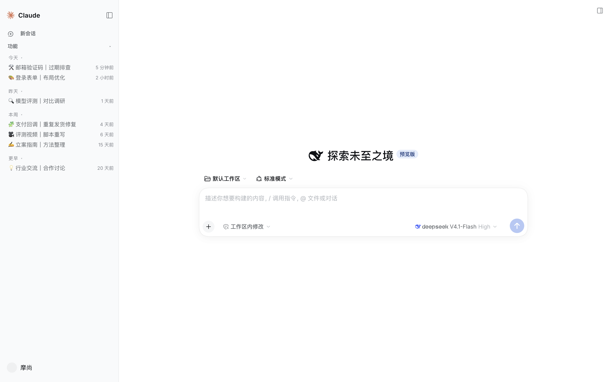
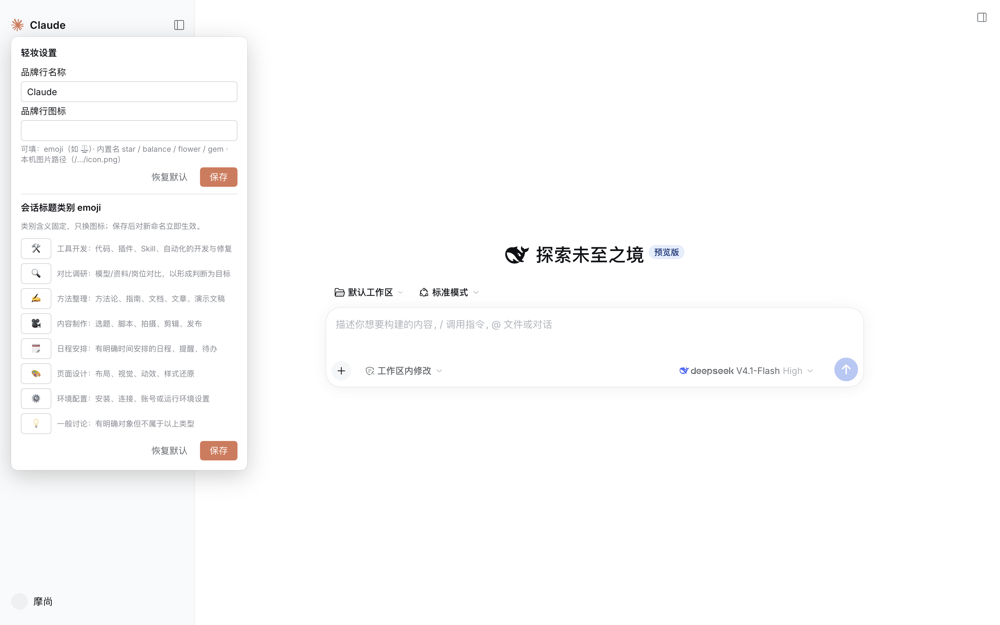

<div align="center">

# 轻妆 · Claude Lite（dsh-claude-lite）

**Claude Code Desktop 观感的轻量复刻套件：皮肤 + 侧栏增强 + 模型行品牌标 + 会话标题整理。**

> 简化不将就：样式体积约为原版的 1/40，客户端脚本零依赖。

## 预览

<table>
  <tr>
    <td align="center" width="50%"></td>
    <td align="center" width="50%"></td>
  </tr>
</table>

</div>

## 署名与来源（重要）

本项目是 [Nwflower/dsh-claude-style](https://github.com/Nwflower/dsh-claude-style)（MIT）的**轻量简化复刻**——观感与设计语言源自原作者，本仓库只做了性能化重写（纯 CSS 令牌重映射 + 零依赖脚本），并非 Anthropic 官方作品，与 Anthropic / DeepSeek 无隶属关系。

- 皮肤观感：源自 [Nwflower/dsh-claude-style](https://github.com/Nwflower/dsh-claude-style)（MIT）
- 会话标题命名规则：源自 [oil-oil/oil-codex-title](https://github.com/oil-oil/oil-codex-title)（MIT）
- 标题状态机：基于 [chancecc99-gif/dsh-title-curator](https://github.com/chancecc99-gif/dsh-title-curator)（MIT）合并而来
- 模型行厂商词标：取自 dsh-claude-style 包（lobe-icons 素材，MIT）

完整第三方声明见 [LICENSE](LICENSE)。

## 安装

```sh
dsh plugin --profile desktop add <本目录或 GitHub 仓库>
```

安装后**重启应用**：插件会自动把皮肤 `claude-lite`（轻妆）安装到皮肤目录，然后在「皮肤中心」里选择并应用「轻妆 · Claude Lite」即可。

## 功能

1. **皮肤（轻妆 claude-lite）**：暖米/暖炭双态、侧栏 24px 密度、衬线正文排版复刻、极光渐变强杀；纯 CSS，零网络字体阻塞。
2. **侧栏日期分组 + 桶折叠**：今天/昨天/本周/更早（只在宿主原生 flat 模式生效，尊重宿主分组选择）。
3. **插件区折叠**：顶部「功能」开关，默认收起。
4. **品牌行自定义**：右键品牌行打开设置浮层——名称任意改、图标三形式（emoji / 内置名 star·balance·flower·gem / 本机图片路径）。
5. **模型行品牌标**：模型选择器里 Claude / DeepSeek / Gemini / GPT / Grok / Kimi / MiniMax / GLM 词标，亮暗双变体。
6. **会话标题整理**（默认开启）：回合结束后自动把会话标题统一成「类别 emoji + 对象｜目标」，只改元数据、不进上下文；手动改名后不再覆盖。
7. **类别 emoji 自定义**：设置浮层里 8 个类别槽位可换 emoji（含义固定，保证自动归类稳定），保存即时生效并持久化。

入口：右键品牌行，或头像菜单 →「轻妆设置」。

## 配置

在 profile 的 `cordis.patch.yml` 里覆盖（插件行 id 为 `ui-claude-lite`）：

```yaml
- id: ui-claude-lite
  config:
    titleCurator:
      enabled: true          # 会话标题整理总开关（默认 true）
      debounceMs: 6000       # 最后一条用户消息后等待多久再评估
      minIntervalMs: 90000   # 同会话两次评估的最小间隔
      maxConcurrent: 1
      timeoutMs: 45000
      maxTokens: 700
```

数据目录：`$DSH_HOME/plugin-data/dsh-claude-lite/`（`state.json` 标题状态 + `audit.jsonl` 审计 + `categories.json` 类别 emoji）。从独立版 dsh-title-curator 迁移时状态会自动搬运，不丢锁定。

## 字体说明

随包分发的字体均为可再分发许可（SIL OFL 1.1）：JetBrains Mono、Inter、Noto Serif。**Anthropic 专有字体不随包分发**（其许可仅限个人使用）——如本机存在，插件的本地安装会自动使用；否则回落系统字体，观感主体（密度/间距/配色/组件）不受影响。

## 许可

MIT，见 [LICENSE](LICENSE)。包含第三方归属声明。
